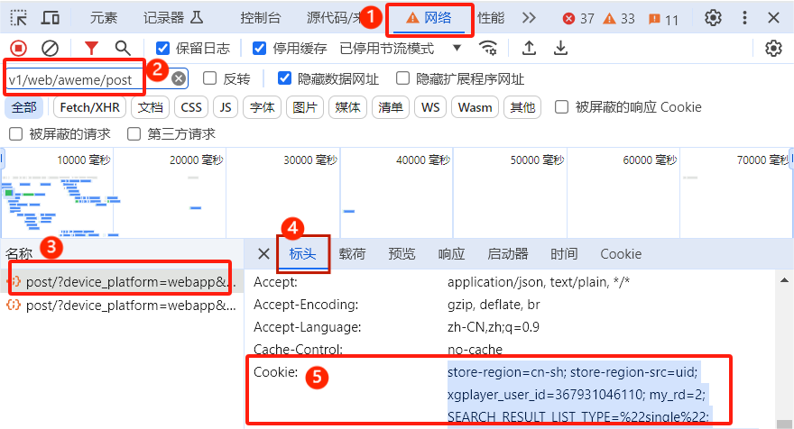

# ✨抖音爬虫

> ❤️[开源不易，欢迎star⭐](#star-history)

## 📢声明

> 本项目初衷为学习`python`爬虫、命令行调用`Aria2`及`python`实现`WebUI`的案例，程序功能为获取抖音平台上公开的信息，仅用于测试和学习研究，禁止用于商业用途或任何非法用途。
>
> 任何用户直接或间接使用、传播本仓库内容时责任自负，本仓库的贡献者不对该等行为产生的任何后果负责。
>
> **如果相关方认为该项目的代码可能涉嫌侵犯其权利，请及时联系我删除相关代码**。
>
> 使用本仓库的内容即表示您同意本免责声明的所有条款和条件。如果你不接受以上的免责声明，请立即停止使用本项目。

---

## 🏠项目地址

> [https://github.com/erma0/douyin](https://github.com/erma0/douyin)

## 🍬功能

🎈获取抖音网页以下公开的数据信息：
  - [x] 指定作品数据
  - [x] 指定用户资料信息
  - [x] 指定用户主页作品数据
  - [x] 指定用户喜欢作品数据
  - [x] 指定用户收藏作品数据
  - [x] 指定音乐原声作品数据
  - [x] 指定挑战话题作品数据
  - [x] 指定合集作品数据
  - [x] 指定用户关注列表数据
  - [x] 指定用户粉丝列表数据
  - [x] 指定关键词搜索作品数据
  - [x] 指定关键词搜索用户数据
  - [ ] 指定关键词搜索直播数据
  - [ ] 指定作品评论数据
  - [ ] 指定作品评论回复数据

PS.

- 支持输入文件路径批量操作（一行一个目标地址）
- 支持增量采集指定用户主页作品
- 部分作品封面不准确，原因不明

## ‍🚩待办

> 💡欢迎PR或建议

- [ ] 完善程序 - 更新功能
- [ ] GUI - Eel

## 🚀使用

> 📍测试环境：`Win10 x64` + `Python3.12`。

> 📭**功能未全部测试，有问题请提交issue（请提供测试链接以便复现问题）**

### 🍪获取cookie

**🟢注意： cookie是有过期时间的，有效cookie内容一般在60条左右。**

> 1. 打开抖音网页版的任意用户主页（推荐使用`Chrome/Edge`浏览器），例如`https://v.douyin.com/iybvCom1/`,再按`F12`打开开发者工具，然后切换到`网络/Network`标签页
>
> 2. 在 `过滤/筛选器` 中输入`v1/web/aweme/post`，找到任一个`post/?`开头的JSON请求（没有请求就刷新一下）
>
> 3. 在`标头/Headers`中往下滑，找到`请求标头/Request Headers`下面的`Cookie`，复制`Cookie`右边的值（可以双击直接全选），再保存到`config/cookie.txt`文件中。
> 
> PS. 可以使用`-c edge/chrome`命令自动获取本地edge/chrome浏览器中的cookie，不过取到的cookie不一定有效，且有效期很短，仅作为备选功能使用（实测chrome有效，Edge经常无效）。

> ⚠️ 据说用作品详情页中`/aweme/v1/web/aweme/detail/`接口请求带的cookie成功率较高，未测试。

### 🉑直接运行

> 下载`dist`目录中的`douyin.exe`，在程序所在目录打开命令行，输入对应命令，或者直接双击打开douyin.exe后根据提示输入目标链接即可。

> ⚠️ Linux或macOS请从[官方地址下载对应的Aria2](https://github.com/aria2/aria2/releases)，然后自行修改源码调试运行

### 🐔命令行使用帮助
```ps
./douyin -h
```

### 🏀命令行使用例子（**先在程序所在目录打开命令行**）
- [x] 获取指定用户主页/音乐/话题/合集/作品等数据
    ```ps
    # 部分类型链接可以自动识别，其他需要使用-t指定类型
    ./douyin -u https://*/
    ./douyin -t search -u https://*/
    ```
    ```ps
    # -t, --type 指定类型：
        'post'：用户主页作品
        'like'：用户喜欢作品
        'music'：音乐原声作品
        'hashtag'：话题作品
        'search'：搜索作品
        'collection'：合集作品
        'favorite'：用户收藏作品
        'video'：单个视频作品
        'note'：单个图文作品
        'follow'：用户关注列表
        'fans'：用户粉丝列表
        'user'：搜索用户
        'live'：搜索直播（暂未实现）
    ```
- [x] 获取当前用户喜欢/收藏作品等数据
    ```ps
    ./douyin -t like
    ```
- [x] 其他功能
    ```ps
    # -l 限制数量，只需要前5条结果
    ./douyin -l 5 -u https://*/

    # 连续输入多个目标地址
    ./douyin -u https://*1/ -u https://*2/

    # 输入文件[user.txt]中的多个目标
    ./douyin -u ./user.txt
    ```

- 💡 手动使用aria2c下载
    ```ps
    aria2c -c --console-log-level warn -i 生成的下载配置文件.txt
    ```
> **也可参考test_douyin.py文件中的代码使用**

## 🔨编译

1. 安装依赖

    ```ps
    pip install -r ./requirements.txt
    ```

2. 安装pyinstaller

    ```ps
    pip install -U pyinstaller
    ```

3. 打包EXE，图标可自行更换

    ```ps
    pyinstaller -F ./cli.py -i ./static/ico.ico -n douyin --add-data "lib:lib" --add-data "aria2c.exe:."

    # 或者使用配置文件
    pyinstaller ./douyin.spec
    ```

## Star History

[](https://star-history.com/#erma0/douyin&Date)
